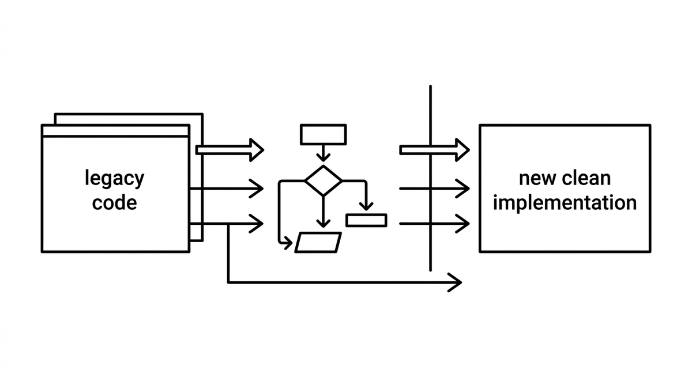

# Clean Room Rewrite

> Deriving a specification from an existing system (its code, observable behavior, or documentation) that captures what the system does without carrying over how it does it, and implementing the new system from that specification alone. The core of the method is the separation of analysis and implementation: the implementing party, human or agent, never sees the original code. In the strict legal sense, this isolation avoids copyright infringement, as in reimplementations built only from public specifications and observed behavior. When modernizing one's own legacy code, the same separation mainly serves quality, because it keeps old structures and compromises from being copied over. Unlike transpilation, which operates at the syntax level, a clean room rewrite works at the level of intent and behavior.

**See also:** [Horseshoe Model](horseshoe-model.md) · [Idiomatic Transpilation](idiomatic-transpilation.md) · [Characterization Test](characterization-test.md)
{ .see-also }
